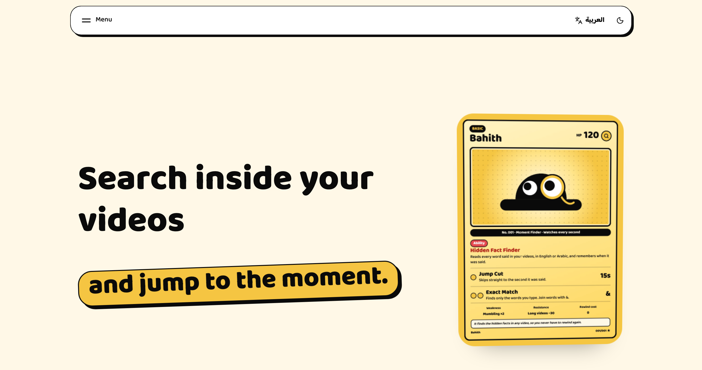
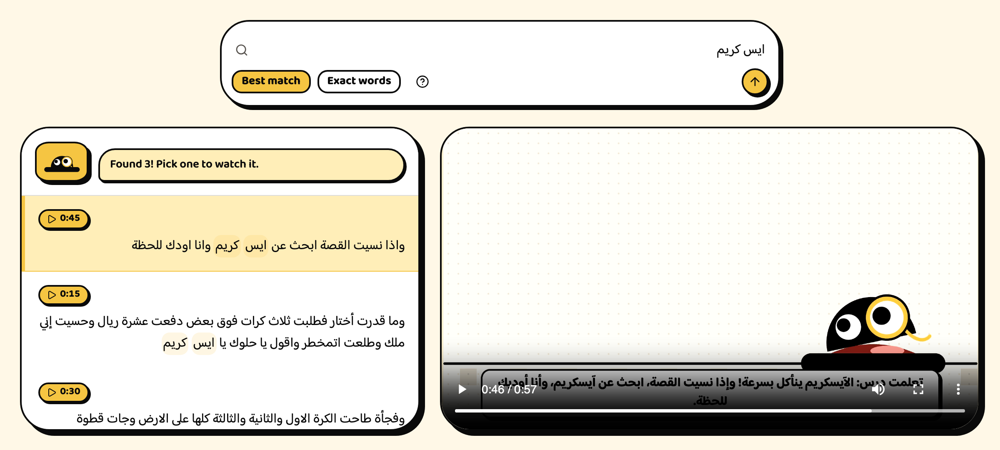
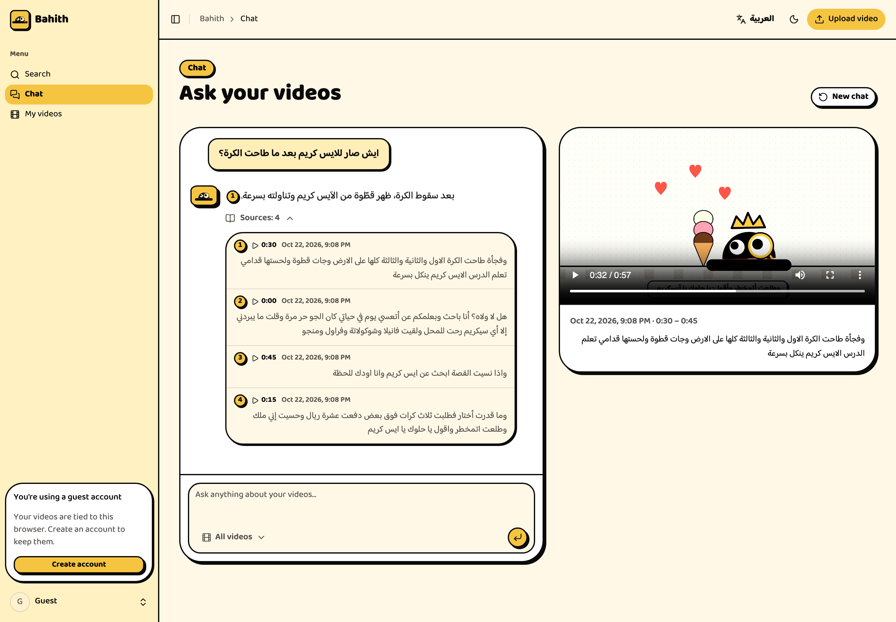
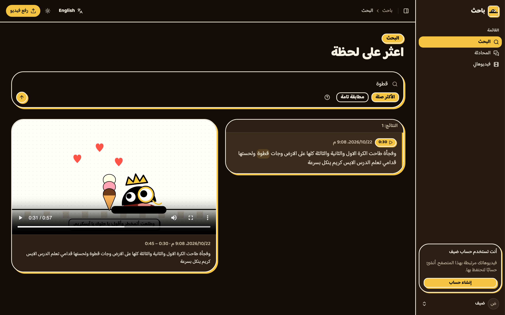
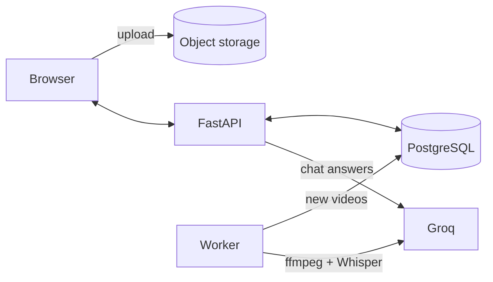

<div align="center">


# Bahith · باحث

**Search what's *said* inside your videos and jump straight to the moment.**

[**Live demo →**](https://bahith.scholarops.dev/)



</div>

Upload a video. Bahith transcribes it and lets you **search** it or **ask questions** about it, in English or Arabic. Every answer links to the exact second it came from.

> Search "gradient descent" in a two-hour lecture → get `0:42:15` → click → the video plays from there.

## Meet Bahith

The landing page demo is a 57-second video in which Bahith, the mascot, tells the story of the worst day of his life: a hot day, three scoops of ice cream, and a cat. Search **ايس كريم** ("ice cream") and he finds every moment it was said. Click a result and the video jumps there.



## Ask your videos

The chat answers **only** from your transcripts and cites its sources. Click a citation to play that moment.



## Arabic first, dark mode included

The whole app works in English and Arabic, with a full right-to-left layout and light and dark themes.



## Under the hood

- **A search engine built from scratch.** An inverted index plus BM25 and Boolean search in [about 100 lines](src/backend/src/search/engine.py) of standard-library Python. No Elasticsearch, no vector database.
- **Videos never touch the API.** The browser uploads straight to storage through a presigned URL, and the signature locks the file size.
- **Workers scale out.** Jobs are claimed with `FOR UPDATE SKIP LOCKED`, so several workers can run at once. Failed jobs are retried up to 3 times.
- **No account needed.** Guests get everything, and their videos come with them when they register.
- **Real auth.** HttpOnly cookies, 15-minute access tokens, and rotating refresh tokens.



## Tech stack

| | |
|---|---|
| **Backend** | Python 3.14, FastAPI, SQLAlchemy 2, Alembic, PostgreSQL 18 |
| **AI** | Groq: Whisper for speech to text, `gpt-oss-20b` for chat |
| **Storage** | S3-compatible: Cloudflare R2 in production, RustFS locally |
| **Frontend** | React 19, TypeScript, Vite, Tailwind v4, shadcn/ui, GSAP, i18next |

## Run it locally

You need Docker and a free [Groq API key](https://console.groq.com).

```bash
cp example.env .env              # add your GROQ_API_KEY and a JWT_SECRET
docker compose up --build        # database, storage, API, worker and frontend
```

Open http://localhost:3030. The API docs are at http://localhost:8000/docs. The storage bucket is created on first start; browse it in the RustFS console at http://localhost:9001 (login `anything` / `anything`).

For frontend hot reload (needs Node 20.19+), stop the frontend container first, because it uses the same port:

```bash
docker compose stop frontend
cd src/frontend && npm install && npm run dev
```

To make the landing page demo work, upload a video, put your user id (from `GET /api/auth/me`) in `DEMO_USER_ID`, and restart the API.

**More docs:** [API reference](src/backend/README.md) · [Design system](src/frontend/design.md)
