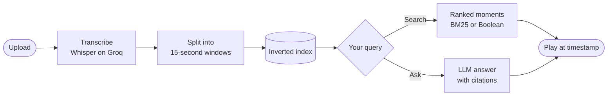
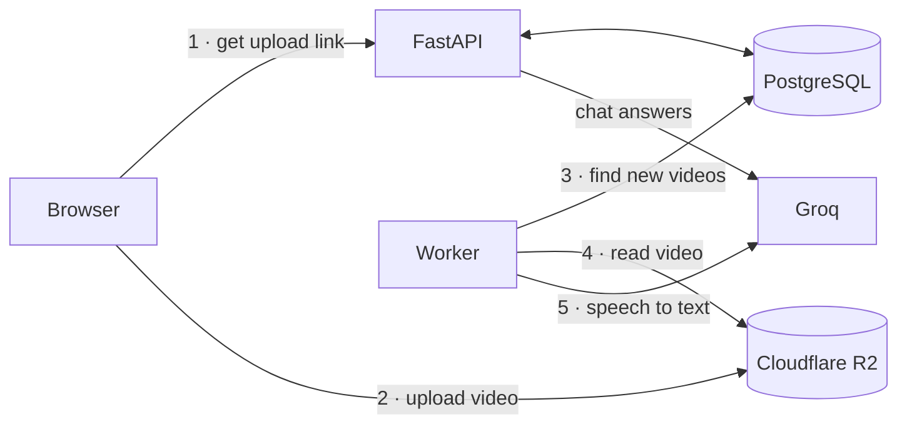

<div align="center">


# Bahith · باحث

**Search what's *said* in your videos and jump straight to the moment.**

[**Live demo →**](https://video-information-retrieval.vercel.app/)

</div>

Upload a video. Bahith transcribes it, splits the transcript into 15-second pieces, and lets you **search** them or **ask questions** about them, in English or Arabic. Every result links to the exact second it came from.

> Search "gradient descent" in a two-hour lecture → get `0:42:15` → click → the video plays from there.

## Features

| | |
|---|---|
| 🔎 **Search** | **Best match** (ranked by BM25) or **Exact words** (Boolean: space = OR, `&` = AND) |
| ⏱️ **Jump to the moment** | Every result has a timestamp; click it to play from that second |
| 💬 **Ask your videos** | A chat answers from your transcripts only and cites sources as `[1]`, `[2]` |
| 👤 **Guest mode** | Try everything without an account; registering later keeps your videos |
| 🌐 **Bilingual** | Full English and Arabic UI with right-to-left layout, light and dark themes |

## How it works



Under the hood:



- Videos go **straight from the browser to R2** through a presigned URL and never pass through the API.
- The **worker** extracts audio with `ffmpeg` in 10-minute chunks and transcribes it with `whisper-large-v3-turbo`. It uses `FOR UPDATE SKIP LOCKED`, so several workers can run at once. Failed jobs are retried up to 3 times.
- **Chat** retrieves the top excerpts with BM25, then `openai/gpt-oss-20b` answers from those excerpts only.

## The search engine

[`search/engine.py`](src/backend/src/search/engine.py) uses only the Python standard library.

- **Tokens:** lowercase `\w+` words, which works for Arabic and English
- **Index:** `term → {doc_id: term frequency}`, cached per user and rebuilt only when their videos change
- **Boolean:** `&` binds tighter than space, so `samsung sony&tv` means *samsung OR (sony AND tv)*
- **BM25:** `k1 = 1.2`, `b = 0.75`

Matching is by whole word, so an English query won't find an Arabic video. To try it on your own corpus (a JSON list of strings):

```bash
cd src/backend && python -m src.search.engine corpus.json "first query" "second query"
```

## Tech stack

| Layer | Tools |
|---|---|
| Backend | Python 3.14, FastAPI, SQLAlchemy 2, Alembic, PostgreSQL 18 |
| AI | Groq: Whisper (speech to text), `gpt-oss-20b` (chat) |
| Storage | Cloudflare R2 with presigned upload and playback links |
| Auth | HttpOnly cookies, 15-min access tokens, rotating refresh tokens, bcrypt |
| Frontend | React 19, TypeScript, Vite, Tailwind v4, shadcn/ui, GSAP, i18next |
| Hosting | Docker Compose (API), Vercel (frontend) |

## Run it locally

**You need:** Python 3.14, Node 20.19+, Docker, `ffmpeg`, a [Groq API key](https://console.groq.com), and a Cloudflare R2 bucket.

```bash
git clone https://github.com/SultanAbdulaziz/Video_Information_Retrieval.git
cd Video_Information_Retrieval
cp example.env .env        # fill in DB, JWT_SECRET, GROQ_API_KEY, S3_* values
```

Add a CORS rule to the R2 bucket (**Settings → CORS Policy**) so the browser can upload:

```json
[{ "AllowedOrigins": ["http://localhost:3030"], "AllowedMethods": ["PUT"],
   "AllowedHeaders": ["content-type"], "MaxAgeSeconds": 3600 }]
```

Then start each part in its own terminal:

```bash
# 1 · Database
docker compose up -d db

# 2 · API → http://localhost:8000/docs
python3 -m venv .venv && source .venv/bin/activate
pip install -r src/backend/requirements.txt
cd src/backend && set -a && source ../../.env && set +a
alembic -c db/alembic.ini upgrade head
uvicorn src.main:app --reload

# 3 · Worker (same env as the API; without it videos stay "Waiting")
python -m src.worker.sweep

# 4 · Frontend → http://localhost:3030
cd src/frontend && npm install && npm run dev
```

<details>
<summary><b>Notes</b></summary>

- `FRONTEND_URL` must exactly match the frontend origin, or CORS will block it.
- The frontend calls `http://localhost:8000/api` unless `VITE_API_URL` is set.
- **Landing page demo:** upload a video, copy your user id from `GET /api/auth/me` into `DEMO_USER_ID`, and restart the API.
- **Limits:** 200 MB per video and 9 GB in total, to stay within R2's free tier.
- All environment variables are listed in the [backend README](src/backend/README.md#environment-variables).

</details>

## Project layout

```
├── compose.yaml · example.env
└── src/
    ├── backend/src/
    │   ├── auth/  file/  storage/     # accounts, uploads, R2
    │   ├── transcription/  worker/    # ffmpeg + Whisper, background jobs
    │   ├── search/  chatbot/          # inverted index, BM25, Q&A
    │   └── demo/                      # public landing page demo
    └── frontend/src/features/
        └── landing  auth  dashboard  search  chat  files  privacy
```

**More docs:** [API reference](src/backend/README.md) · [Design system](src/frontend/design.md)
